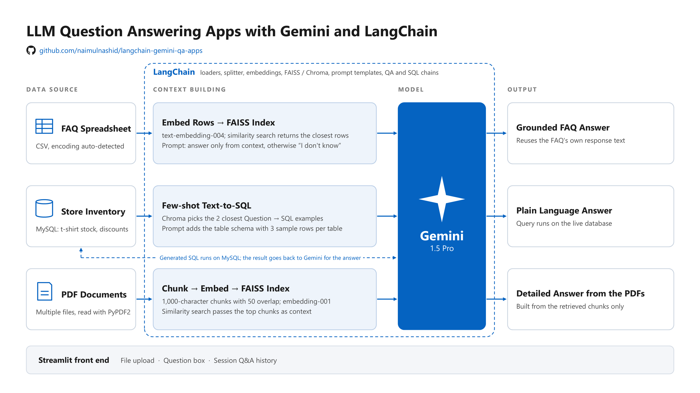
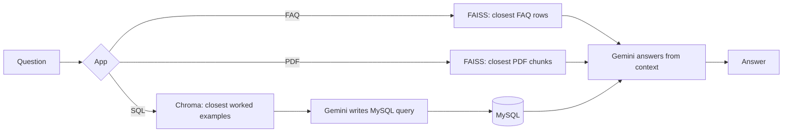

# LLM Question Answering Apps with Gemini and LangChain

Three Streamlit apps that answer questions from your own data: an FAQ spreadsheet, a MySQL database and PDF files. Each uses LangChain to retrieve the relevant context and Google Gemini to write the answer. Self-study project, July to August 2024; the FAQ and SQL apps build on codebasics tutorial projects (see Credits).

This repository is a project showcase, not a maintained library.



## Demo

| [`faq-csv-qa`](faq-csv-qa/) | [`text-to-sql-qa`](text-to-sql-qa/) | [`pdf-qa`](pdf-qa/) |
|---|---|---|
| <a href="https://youtu.be/h75u9rPm074"></a> | <a href="https://youtu.be/XAwvaj48y_Q"></a> | <a href="https://youtu.be/pO9Evp1qQKo"></a> |

Demo videos on YouTube, recorded July 2024: [FAQ spreadsheet](https://youtu.be/h75u9rPm074), [SQL database](https://youtu.be/XAwvaj48y_Q), [PDF files](https://youtu.be/pO9Evp1qQKo).

## Features

| App | What it does | How |
|---|---|---|
| [`faq-csv-qa`](faq-csv-qa/) | Answers questions from an uploaded FAQ spreadsheet and says "I don't know" when the answer is not in it | Detects the file's encoding, embeds each row, retrieves the closest rows with FAISS, and asks Gemini to answer from them only |
| [`text-to-sql-qa`](text-to-sql-qa/) | Answers inventory questions about a T-shirt store's MySQL database ("How many white Levi's T-shirts are left?") | Turns the question into a MySQL query with LangChain's SQL chain, choosing the two most similar worked examples (few-shot, stored in Chroma) to guide the query |
| [`pdf-qa`](pdf-qa/) | Answers questions from one or more uploaded PDFs | Extracts the text, splits it into 1,000-character chunks, retrieves the closest chunks with FAISS and asks Gemini to answer from them |

Each app keeps the session's questions and answers on screen.

## Installation and getting started

Prerequisites: Python 3.10 or later, a [Gemini API key](https://aistudio.google.com/apikey), and for `text-to-sql-qa` a local MySQL server.

```bash
git clone https://github.com/naimulnashid/langchain-gemini-qa-apps.git
cd langchain-gemini-qa-apps/faq-csv-qa      # or text-to-sql-qa, pdf-qa
python -m venv venv
venv\Scripts\activate                        # Windows; on macOS or Linux: source venv/bin/activate
pip install -r requirements.txt
```

For `text-to-sql-qa`, create the sample database first: `mysql -u root -p < database/atliq_tshirts.sql`.

No releases are published: each app runs from source.

## Configuration

Each app reads its settings from a `.env` file in its own folder. Copy `.env.example` to `.env` and fill it in:

| Variable | Used by | Meaning |
|---|---|---|
| `GOOGLE_API_KEY` | all three | Your Gemini API key |
| `DB_USER`, `DB_PASSWORD`, `DB_HOST`, `DB_NAME` | `text-to-sql-qa` | MySQL login and database (defaults: `root`, empty, `localhost`, `atliq_tshirts`) |

The apps were written in 2024 against `gemini-1.5-pro-001` (FAQ and SQL apps) and `gemini-pro` (PDF app). Google has since replaced these models, so the model names in each `app.py` may need updating to a current Gemini model.

## Usage

```bash
streamlit run app.py
```

- **FAQ:** upload a CSV with `prompt` and `response` columns (for example [`faqs.csv`](faq-csv-qa/faqs.csv)), build the knowledge base, then ask.
- **SQL:** ask in plain English; [`sample_questions.txt`](text-to-sql-qa/sample_questions.txt) has examples.
- **PDF:** upload PDFs in the sidebar, press Submit, then ask.

## Tech stack and architecture

Python, Streamlit for the interface, LangChain for retrieval and chains, Google Gemini for the language model and embeddings, FAISS and Chroma as vector stores, MySQL with SQLAlchemy and PyMySQL for the database app.



## Security and privacy

- Keys and the database password live only in each app's `.env`, which is ignored by Git. Never commit it.
- Questions and the retrieved text are sent to Google's Gemini API, so do not upload confidential files.
- The FAQ and PDF apps load their saved FAISS index with `allow_dangerous_deserialization=True`. That is safe only for indexes the app built itself on your machine, never for one downloaded from elsewhere.

## Development

The project is complete and not under development. Each app is a single `app.py` in its own folder with its own `requirements.txt`.

## Credits, license and support

- The FAQ and SQL apps build on [codebasics](https://codebasics.io/) LangChain tutorial projects: `faqs.csv` (codebasics bootcamp FAQs) and the AtliQ T-shirts database are theirs.
- No license is granted for this repository: it is shared to show the work, not for reuse.
- This is a personal showcase, so issues and pull requests are not monitored.
